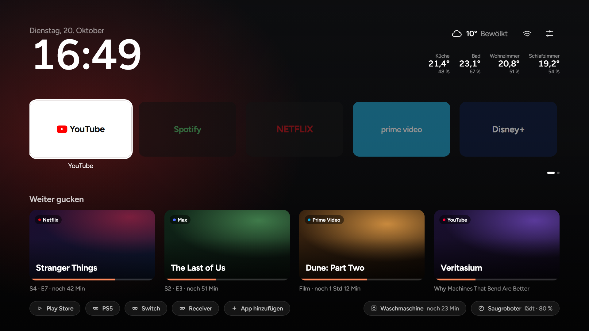

<div align="center">

# TV Detox

### Ein ruhiger Startbildschirm für einen alten Android-TV.

Meine Fassung von [Ansub/tv-detox](https://github.com/Ansub/tv-detox): Uhr, Wetter, Weiter-gucken, eigener Hintergrund, und auf Wunsch die Home-Assistant-Zeile.

Bauen und auf den Fernseher bringen: [docs/anleitung.md](docs/anleitung.md).

[](LICENSE)

### Mit Home Assistant



Raumtemperaturen oben rechts, Waschmaschine und Saugroboter unten.

### Ohne Home Assistant


Dieselbe Fläche: Uhr, Wetter, Apps und Weiter-gucken.

</div>

Die Home-Assistant-Zeile (Räume, Waschmaschine, Saugroboter) zeigt die Vorschau mit Beispieldaten. Auf dem Fernseher sind Uhr, Wetter, Weiter-gucken und der Hintergrund.

<table>
<tr>
<td width="33%" valign="top"><b>🧹 Räumt den Ballast weg</b><br>Bloatware, Werbung und gesponserte Zeilen sind weg.</td>
<td width="33%" valign="top"><b>📺 Ein ruhiger Startbildschirm</b><br>Deine Apps, deine HDMI-Eingänge und eine Uhr. Sonst nichts.</td>
<td width="33%" valign="top"><b>↩️ Jederzeit zurück</b><br>Apps werden ausgeschaltet, nie gelöscht.</td>
</tr>
</table>

## Loslegen

Die durchgängige Anleitung für Windows, Bauen, Installieren, Hintergrund und Aufräumen: **[docs/anleitung.md](docs/anleitung.md)**.

**1. Entwicklermodus am Fernseher einschalten.**
Einstellungen → Gerätepräferenzen → Info → **Build** 7-mal drücken. Danach **USB-Debugging** in den **Entwickleroptionen** an. [Hängt es?](#hilfe)

**2. [Claude Code](https://claude.com/claude-code) oder [Codex](https://openai.com/codex) auf dem Laptop öffnen.**
Laptop und Fernseher müssen im selben WLAN sein. Ohne KI reicht [docs/anleitung.md](docs/anleitung.md).

**3. Diesen Text einfügen.**

```text
Hilf mir, meinen Android-TV aufzuräumen und schneller zu machen.
Mein Fernseher ist ein <Marke und Modell>.

1. Verbinde dich über WLAN mit dem Fernseher. Führe mich durch
   alles, was ich am Gerät tippen muss.
2. Bevor du etwas änderst, liste jede App auf Deutsch:
   gefahrlos aus, vom Fernseher gebraucht, und Apps, die ich nutze.
   Prüfe den freien Speicher.
3. Frag mich vor jeder Änderung. Schalte Apps aus, statt sie
   zu löschen. Führe eine Liste, was du geändert hast und wie
   man es rückgängig macht.
4. Nie ausschalten: Google-Play-Dienste
   (com.google.android.gms), Google Play, Einstellungen,
   Systemoberfläche, Einrichtungs-Apps, die Tastatur, Bluetooth,
   meine HDMI-Eingänge, das Eingangs- und Tuner-Framework des
   Fernsehers, und alles andere, das der Fernseher zum Starten
   braucht. Im Zweifel an lassen. Die eine Ausnahme: wenn
   install.sh anbietet, die Einrichtungs-App von Google TV
   auszuschalten, weil sie Home übernimmt, frag mich zuerst.
5. Installiere den Startbildschirm aus diesem Projektordner:
   sh build.sh und danach sh install.sh mit meinem Fernseher
   und diesen Apps: <deine Apps>.
6. Schalte Animationen und den Bildschirmschoner aus und lass
   den Fernseher nach 5 Minuten schlafen.
7. Warte 30 Sekunden nach der letzten Änderung, starte den
   Fernseher einmal neu und prüfe, dass er normal hochfährt,
   bevor du sagst, du bist fertig. Zeig mir den freien Speicher
   davor und danach.
```

Danach fragt es vor jeder Änderung.

> [!NOTE]
> Das hat bei uns funktioniert, es ist kein professioneller Rat. Nutzung auf eigenes Risiko. Du bist für deinen Fernseher verantwortlich.

## Hilfe

<details>
<summary><b>Wie schalte ich den Entwicklermodus ein?</b></summary>
<br>

1. Am Fernseher **Einstellungen**, dann **Gerätepräferenzen** (oder **System**), dann **Info**.
2. Auf **Build** 7-mal OK drücken, bis „Du bist jetzt Entwickler“ erscheint.
3. Zurück, **Entwickleroptionen** öffnen und **USB-Debugging** einschalten. Gibt es **Netzwerk-Debugging** oder **Wireless debugging**, das auch einschalten.
4. Beim ersten Verbinden fragt der Fernseher „Debugging zulassen?“. „Immer zulassen“ anhaken und **Zulassen** drücken.

Die Menüs unterscheiden sich je nach Marke. Wenn es hakt: *„Ich habe einen Fernseher \<Marke und Modell\>. Wie verbindest du dich von meinem Laptop und übernimmst die Steuerung?“*

</details>

<details>
<summary><b>Auf welchen Fernsehern funktioniert das?</b></summary>
<br>

Android TV 9 (ein echter Fernseher), 11 und 12, und Google TV 14 (ebenfalls ein echter TCL, siehe [TCL-Notizen](#tcl-notizen)). Jede Änderung wird automatisch auf Emulatoren geprüft.

</details>

<details>
<summary><b>Geht das auf Fire TV, Roku, Samsung oder LG?</b></summary>
<br>

- **Amazon Fire TV:** teilweise. Fire TV ist darunter Android, das Aufräumen funktioniert. Amazon blockiert auf aktuellen Fire TVs den Wechsel des Startbildschirms, du behältst also Amazons Bildschirm. Sag, was bleiben soll, zum Beispiel Alexa-Sprachsuche auf der Fernbedienung.
- **Roku:** nein. Roku hat ein eigenes System, kein Android. Nichts kann sich verbinden und Apps ausschalten.
- **Samsung (Tizen):** nein, aus demselben Grund.
- **LG (webOS):** nein. Werbung lässt sich trotzdem eindämmen, indem du **Home-Promotion** und **Inhaltsempfehlung** in den Home-Einstellungen des Fernsehers ausschaltest.

Läuft der Fernseher oder die Streaming-Box mit Android TV oder Google TV, sollte es gehen. Dazu gehören viele Sony, TCL, Hisense, Philips und Xiaomi, Chromecast mit Google TV und Nvidia Shield. Manche dieser Marken verkaufen auch Roku oder andere Systeme. Im Zweifel unter **Einstellungen > Info** nachsehen.

</details>

<details>
<summary><b>Was ist mit Projektoren oder Android-Handys?</b></summary>
<br>

- **Android-Projektoren:** wahrscheinlich. Gibt es **Entwickleroptionen** und **USB-Debugging**, sollte das Aufräumen gehen. Billige Projektoren laufen oft mit einem eigenen Android, der Startbildschirm kann sich etwas anders verhalten.
- **Android-Handys:** nur das Aufräumen. Der Startbildschirm ist für eine Fernbedienung gebaut, nicht für Touch.

</details>

<details>
<summary><b>Worauf achten bei Chromecast mit Google TV?</b></summary>
<br>

Darauf läuft dasselbe Google TV, mit dem das geprüft wurde. Zwei Rückmeldungen von Leuten, die es gemacht haben:

- Die YouTube-Taste der Fernbedienung kann ausfallen, und bei manchen fällt Cast weg. Cast an lassen, wenn du es nutzt.
- Google TV kann seinen eigenen Startbildschirm zurückholen. Dann den Google-TV-Startbildschirm ausschalten lassen. Die Einrichtungs-App an lassen, außer sie übernimmt Home (siehe unten).

</details>

<details>
<summary><b>Home öffnet den Einrichtungsbildschirm von Google TV (Sony BRAVIA und andere)</b></summary>
<br>

Auf manchen Google TVs wählt Android die Einrichtungs-App (`com.google.android.tungsten.setupwraith`) als Home, sobald der Google-TV-Startbildschirm (`com.google.android.apps.tv.launcherx`) aus ist. `install.sh` erkennt das und fragt, bevor es die Einrichtungs-App auch ausschaltet. Es fragt nur, wenn Home genau diese App öffnet, der Google-TV-Startbildschirm schon aus ist und die Ersteinrichtung des Fernsehers fertig ist. `YES=1` schaltet sie nicht aus. Dafür `YES_SETUP=1`. Das hat auf einem Sony BRAVIA und einem TCL Smart TV Pro (Google TV 14) funktioniert, ist aber nicht auf jedem Fernseher geprüft. `undo.sh` schaltet sie wieder ein.

Von Hand zurück:

```sh
adb shell pm enable com.google.android.tungsten.setupwraith
adb shell pm enable com.google.android.apps.tv.launcherx
```

Fragt der Fernseher wieder nach der Einrichtung, oder bleibt ein Einrichtungsbildschirm hängen, zuerst die Einrichtungs-App wieder einschalten.

</details>

<a id="tcl-notizen"></a>
<details>
<summary><b>TCL-Fernseher: was funktioniert hat und was an bleiben soll</b></summary>
<br>

Geprüft auf einem TCL Smart TV Pro (Google TV, Android 14, 2,3 GB RAM). Nach jedem Schritt unten kam ein Neustart, und der Fernseher startete jedes Mal normal. Der freie Speicher ging von etwa 660 MB auf etwa 1 GB. Ein Teil davon kommt nur vom Neustart: die erste Zahl wurde gemessen, nachdem der Fernseher 15 Tage an war.

**Startbildschirm.** Mit ausgeschaltetem Google-TV-Startbildschirm öffnete Home den Wiederherstellungsbildschirm der Einrichtungs-App, wie in [#16](https://github.com/Ansub/tv-detox/issues/16). Die Einrichtungs-App ebenfalls aus (`YES_SETUP=1`), dann blieb dieser Startbildschirm, über mehrere Neustarts.

**Verbinden auf Port 5555.** Wer über **Wireless debugging** (Pairing-Code) verbunden war, verliert die Verbindung mitten in `install.sh`, sobald die Einrichtungs-App aus geht. Das Skript sagt dann, es konnte die Einrichtungs-App nicht ausschalten, obwohl es das getan hat. Auf diesem Fernseher ging auch der klassische Port. Neu verbinden mit `adb connect <TV_IP>:5555`, prüfen mit `adb shell pm list packages -d`, und `install.sh` noch einmal mit dieser Adresse.

**Gefahrlos aus**, wenn du sie nicht nutzt:

| App | Paket |
|---|---|
| TCL-Konto | `com.tcl.usercenter` |
| Eingebaute Anleitung | `com.tcl.ocean.instructions` |
| TCL Channel (Gratis-Sender mit Werbung) | `com.tcl.channelplus` |
| TCL-Empfehlungen | `com.tcl.waterfall.overseas` |
| TCL-Hinweise und Werbung | `com.tcl.messagebox` |
| Laden-Demo | `com.tcl.esticker`, `com.tcl.exhibit` |
| Alexa eingebaut | `com.tcl.smartalexa` |
| Handy-Verbindung | `com.tcl.magiconnectfree` |
| Reparaturhilfe, Logs | `com.tcl.repairguide`, `com.tcl.logkit` |
| Bildschirmspiegelung | `com.tcl.miracast` |
| TCL-Analyse und Alexa-Anbindung | `com.tcl.ttvs` |
| TCL-Interaktiv und Werbung | `com.tcl.interactive` |
| Spielleiste für Konsolen | `com.tcl.gamebar` |
| Fotobetrachter, USB-Mediaplayer | `com.tcl.gallery`, `com.tcl.ui_mediaCenter` |
| App-Verwalter | `com.tcl.guard` |
| Bluetooth „allein hören“ | `com.tcl.t_solo` |
| Bildschirmschoner von Google TV (etwa 200 MB) | `com.google.android.apps.tv.dreamx` |

**Kacheln, die nach dem Aufräumen bleiben.** Zwei TCL-Kacheln können auf diesem Startbildschirm weiter auftauchen. **TCL Channel** ist `com.tcl.partnercustomizer` und bedient auch die TCL-Taste der Fernbedienung. **TCL Home** ist `com.tcl.dashboard`, das Schnelleinstellungsfeld von TCL. Beide ließen sich ohne Ärger ausschalten.

**Diese an lassen:**

- `com.tcl.tvinput`: die HDMI-Eingänge und der Tuner.
- `com.tcl.suspension`: die Eingangsauswahl.
- `com.tcl.inputmethod.international`: die TCL-Tastatur.
- `com.tcl.providers.config`: andere TCL-Apps lesen ihre Einstellungen daraus.
- `com.tcl.useragreement`: die Datenschutzschalter von TCL.

`com.tcl.tv` ist Live-TV, der Programmführer und der Sendersuchlauf. Nur ausschalten, wenn du nie Antenne oder Kabel schaust.

**Optional: die Handy-Tastatur kommt immer wieder.** Auf diesem Fernseher hat der Handy-Fernbedienungsdienst von Google TV nach jedem Neustart seine Handy-Tastatur wieder zur TV-Tastatur gemacht. Wenn das passiert, zuerst notieren, welche Tastatur jetzt aktiv ist:

```sh
adb shell settings get secure default_input_method
```

Dann auf die TCL-Tastatur wechseln und den Handy-Fernbedienungsdienst ausschalten:

```sh
adb shell ime set com.tcl.inputmethod.international/.T_IME
adb shell pm disable-user --user 0 com.google.android.tv.remote.service
```

Damit funktioniert das Handy nicht mehr als Fernbedienung: kein Tippen, keine Sprachsuche, keine Steuerung aus der Google-TV- oder Google-Home-App. `undo.sh` macht das nicht rückgängig. Von Hand: den Dienst wieder einschalten und zur notierten Tastatur zurück:

```sh
adb shell pm enable com.google.android.tv.remote.service
adb shell ime set <die notierte Tastatur>
```

**Das TCL-Logo beim Start** steckt in der Firmware und lässt sich nicht ausschalten. Auf diesem Fernseher hat Ausschalten mit der Fernbedienung (nicht an der Steckdose) den Schnellstart von TCL direkt auf den Startbildschirm geweckt, ohne Logo.

</details>

<details>
<summary><b>Die Claude-App sagt, sie erreicht meinen Fernseher nicht</b></summary>
<br>

Der Chat in der Claude-App (und auf claude.ai) läuft auf den Servern von Anthropic, nicht auf deinem Laptop, und sieht den Fernseher nicht. Du brauchst etwas, das auf deinem eigenen Laptop läuft: [Claude Code](https://claude.com/claude-code) oder [Codex](https://openai.com/codex).

Weder das eine noch das andere zahlen? Die KI weglassen und `install.sh` benutzen (siehe unten und [docs/anleitung.md](docs/anleitung.md)).

</details>

<details>
<summary><b>Geht das vom Handy, ohne Laptop?</b></summary>
<br>

Noch nicht. Die Steuerung muss auf einem Computer im selben Netz wie der Fernseher laufen. Ein Handy-Hotspot als dieses Netz geht, solange Laptop und Fernseher beide darin sind.

</details>

<details>
<summary><b>Mein Fernseher hängt am Ethernet, nicht am WLAN</b></summary>
<br>

Das funktioniert genauso. Der Laptop spricht den Fernseher über seine IP im Heimnetz an, Kabel oder WLAN ist egal. Der Laptop muss nur im selben Netz sein. Die IP steht in den Netzwerkeinstellungen des Fernsehers.

</details>

<details>
<summary><b>Kann ich nur aufräumen und den Startbildschirm des Fernsehers behalten?</b></summary>
<br>

Ja. Schritt 5 der Eingabe weglassen („Installiere den Startbildschirm“). Der Fernseher sieht aus wie vorher, nur ohne den Ballast.

</details>

<details>
<summary><b>Woher weiß ich, welche Apps ich ausschalten darf?</b></summary>
<br>

Den Planer laufen lassen. Er liest den Fernseher und druckt jede App mit einem Urteil, ohne etwas zu ändern:

```sh
sh candidates.sh <TV_IP>
```

`never` braucht der Fernseher, `keep` trägt eine Funktion, die du nutzen kannst, `safe` ist üblicher Ballast, `review` ist unbekannt. [docs/debloat.md](docs/debloat.md) erklärt die Urteile, die Fallen (Apps, die Android immer wieder startet, die App, in der Cast steckt, Paketnamen, die verbergen, was die App wirklich ist) und die Listen „nie anfassen“ und „oft gefahrlos aus“.

</details>

<details>
<summary><b>Warum nicht einfach Projectivy Launcher?</b></summary>
<br>

Das geht. Das Aufräumen macht den Fernseher schneller und funktioniert mit jedem Startbildschirm. Dieser hier ist da, wenn du etwas Kleines und Open Source willst: ein Bildschirm, keine Werbung, kein Konto, etwa 30 MB RAM.

</details>

<details>
<summary><b>Der Fernseher öffnet beim Einschalten weiter Live-TV oder HDMI</b></summary>
<br>

Das ist eine Einstellung des Fernsehers, nicht dieser Startbildschirm. *„Mein Fernseher öffnet beim Start Live-TV statt des Startbildschirms. Finde die Einstellung und schalte sie aus.“*

</details>

<details>
<summary><b>Eine Taste der Fernbedienung geht nicht mehr</b></summary>
<br>

Manche Tasten bedient der eigene Startbildschirm des Fernsehers oder eine App, die das Aufräumen ausgeschaltet hat. Welche App welche Taste hat: *„Führe `adb shell dumpsys window policy` aus und sag mir, auf welche Apps die globalen Tasten meiner Fernbedienung gehen.“* Ist es eine andere App als der Startbildschirm des Fernsehers, diese App wieder einschalten.

**Die YouTube-Taste auf manchen Google TVs** (gesehen bei Xiaomi und Vu): sie geht auf den eigenen Startbildschirm von Google TV, den `install.sh` ausschaltet. Die Taste tut dann nichts. Diesen Startbildschirm wieder einschalten bringt die Taste zurück, der Fernseher kann dann aber wieder Google TV öffnen statt dieses Bildschirms. Bis es eine sichere Lösung gibt, YouTube über die Kachel auf dem Startbildschirm öffnen.

</details>

<details>
<summary><b>Ein Update hat etwas wieder eingeschaltet</b></summary>
<br>

```sh
sh check.sh <TV_IP>                  # prüfen, ob der Startbildschirm noch vorne ist
sh check.sh <TV_IP> --fix            # und reparieren
sh check.sh <TV_IP> --fix my-tv.txt  # zusätzlich die eigene Änderungsliste prüfen
```

Die Liste hat eine Änderung pro Zeile, zum Beispiel `off com.example.app`, `global window_animation_scale 0` oder `device_config activity_manager max_cached_processes 4`.

</details>

<details>
<summary><b>Kann ich den Startbildschirm ohne KI installieren?</b></summary>
<br>

Ja. Du brauchst nur `adb`. Auf dem Mac: `brew install android-platform-tools`. Unter Windows die [SDK Platform Tools](https://developer.android.com/tools/releases/platform-tools) von Google entpacken und die Befehle in Git Bash ausführen. Die eigene Fassung: [docs/anleitung.md](docs/anleitung.md). Kurz:

```sh
sh build.sh
sh install.sh <TV_IP>                                               # sucht die TV-Apps selbst
sh install.sh <TV_IP> "com.netflix.ninja,com.hulu.livingroomplus"   # oder selbst wählen
sh install.sh <TV_IP> "" "bluetooth,sound,picture"                  # Einstellungskürzel dazu
```

Die meisten Fernseher öffnen weiter ihren eigenen Startbildschirm. Das Skript bietet an, den auszuschalten. Nichts wird deinstalliert.

Die Aufräum-Hälfte ist eine Entscheidung pro App und deshalb nicht automatisch. `sh candidates.sh <TV_IP>` listet jede App mit Urteil, [docs/debloat.md](docs/debloat.md) enthält die Regeln.

</details>

<details>
<summary><b>Wie ändere ich die Apps auf dem Startbildschirm?</b></summary>
<br>

Mit der Fernbedienung. **OK** auf einer App halten (oder **Menü** drücken):

- **Verschieben:** mit den Pfeilen an die neue Stelle, dann **OK**.
- **Ersetzen:** eine andere App nimmt den Platz.
- **Vom Startbildschirm entfernen.** Die App bleibt installiert und kann jederzeit zurück.
- **Deinstallieren**, für Apps, die du selbst installiert hast. Der Fernseher fragt vorher.
- **App-Info**, für Apps, die mit dem Fernseher kamen. Die lassen sich nicht deinstallieren, von dort aber ausschalten.

Eine App dazu: die Kachel **App hinzufügen** in der unteren Zeile. So viele Apps wie du willst. Sie laufen in Reihen zu fünfen, die Seite blättert weiter. Deine Änderungen bleiben, bis du `install.sh` mit einer neuen Appliste startest.

</details>

<details>
<summary><b>Kann ich WLAN und Bluetooth auf einen Tastendruck legen?</b></summary>
<br>

Ja. Neben der Uhr sitzt immer ein kleines Netz-Symbol. Es zeigt **WLAN** (mit Balken), **Ethernet** oder durchgestrichenes WLAN, wenn du offline bist, und öffnet die Netzwerkeinstellungen. **Bluetooth**, **Ton** und **Bild** können dazukommen. Die sind aus, bis du sie verlangst:

```sh
sh install.sh <TV_IP> "" "bluetooth,sound,picture"   # beliebige davon, in beliebiger Reihenfolge
sh install.sh <TV_IP> "" "none"                      # wieder weg
```

Von den Apps aus **Hoch** drücken, um sie zu erreichen. Ein Kürzel, für das der Fernseher keinen Bildschirm hat, wird weggelassen. Auf TCL öffnen Ton und Bild die eigenen TCL-Flächen.

</details>

<details>
<summary><b>Wie mache ich es rückgängig?</b></summary>
<br>

```sh
sh undo.sh <TV_IP>
```

Das schaltet den eigenen Startbildschirm des Fernsehers wieder ein und entfernt diesen. Das Aufräumen zusätzlich zurück: jede notierte App mit `adb shell pm enable <Paket>` einschalten.

</details>

<details>
<summary><b>Mein Fernseher startet immer wieder neu</b></summary>
<br>

Der Laptop erreicht ihn oft ein paar Sekunden lang, jedes Mal wenn er startet. In der Zeit alles wieder einschalten:

```sh
adb connect <TV_IP>
adb wait-for-device
adb shell pm list packages -d
```

Das listet alles Ausgeschaltete. Jede App mit `adb shell pm enable <Paket>` zurück, oder alle auf einmal:

```sh
for p in $(adb shell pm list packages -d | tr -d '\r' | sed 's/package://'); do adb shell pm enable "$p"; done
```

Nur den Startbildschirm zurück: `sh undo.sh <TV_IP>`. Danach den Fernseher neu starten. Das Aufräumen kannst du später App für App wiederholen.

Erreicht der Laptop ihn nie, Recovery oder Werksreset des Fernsehers. Der Weg hängt von Marke und Modell ab, also die Support-Seite des Herstellers.

</details>

<details>
<summary><b>Für Entwickler: selbst bauen</b></summary>
<br>

Die Windows-Schritte stehen in [docs/anleitung.md](docs/anleitung.md) und [docs/build.md](docs/build.md).

1. Standard-Apps in `apps.txt` (Paketnamen, eine pro Zeile). Oder an `install.sh` übergeben.
2. Java 17 und das Android SDK. Auf dem Mac:
   ```sh
   brew install openjdk@17
   brew install --cask android-commandlinetools
   sdkmanager "platforms;android-34" "build-tools;34.0.0"
   ```
3. `sh build.sh`, danach installiert `sh install.sh <TV_IP>` deinen Build statt der Release.
4. `sh ci/smoke-test.sh <TV_IP oder Emulator>` prüft, ob alles läuft.

HDMI-Eingänge findet er selbst. Die Beschriftungen folgen der Sprache des Fernsehers, 16 Sprachen sind eingebaut. Eine Sprache ergänzen oder eine Übersetzung korrigieren: `src/com/ansub/tvhome/Strings.java`. `key.jks` behalten, die beim ersten Build entsteht: Updates müssen mit demselben Schlüssel signiert sein.

Ein Bildschirm in einfachem Java, keine Bibliotheken, kein Gradle. Der Hintergrund wird einmal gezeichnet, die einzige Animation ist das Anheben beim Fokus, und er braucht etwa 30 MB RAM.

</details>

## Mitmachen

Pull Requests sind willkommen für Korrekturen, die auf jedem Fernseher weiter funktionieren. Das Projekt bleibt bei offiziellen Apps und den Einstellungen von Android. Änderungen, die Werbeblocker oder inoffizielle Apps dazunehmen, werden nicht gemergt. Wer das will, forkt das Projekt und macht es zu seinem.

---

<div align="center">

**Marcel Mühmel**

Fork von [Ansub/tv-detox](https://github.com/Ansub/tv-detox) · [Ecentrix/tv-detox](https://github.com/Ecentrix/tv-detox)

<sub>MIT-Lizenz</sub>

</div>
